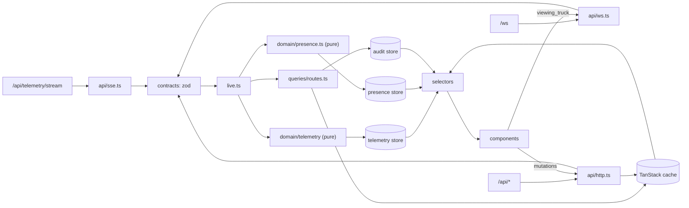

# FleetPulse: real-time fleet dashboard

## Setup

Requires Node ≥ 20 and the latest Chrome.

```bash
npm install
npm start     # mock server on :3000 + Vite dev server on :5173 (open http://localhost:5173)
npm test      # typecheck + all tests
```

`server.js` is the assignment's mock server, unchanged. `.gitattributes` marks it `-text` so a Windows checkout never rewrites its line endings.
`npm run capture-fixtures` regenerates `tests/fixtures/*.json` from a fresh server instance.

## Architecture

API clients validate every inbound payload with zod and hand typed messages to one composition root
(`src/live.ts`). Telemetry goes through a pure TypeScript pipeline, with no React, into a Zustand store.
REST data lives in TanStack Query, and WebSocket route events are written into the same cache.
Components read through per-truck selectors.



| Folder            | Responsibility                                                                                                                                                           |
| ----------------- | ------------------------------------------------------------------------------------------------------------------------------------------------------------------------ |
| `src/api/`        | Talks to the server: `endpoints.ts` (every URL and header name), `http.ts` (the ky instance), one file per resource (`fleet.ts`, `routes.ts`), SSE and WebSocket clients |
| `src/contracts/`  | zod schema + inferred type for every payload, one file per domain                                                                                                        |
| `src/domain/`     | Pure TypeScript, no React: telemetry pipeline, sensor log, route rules, presence                                                                                         |
| `src/stores/`     | Zustand stores for live data                                                                                                                                             |
| `src/queries/`    | TanStack Query hooks (`useFleet`, `useTruckName`, `useRoutes`, …), cache keys in `keys.ts`, cache updates. Query options stay private to each file                       |
| `src/mutations/`  | TanStack mutation hooks (routes, alerts), the 409 → "who changed it" lookup, and `mutationErrorMessage`, the one place a failed mutation becomes text                    |
| `src/context/`    | `SessionContext`: identity and socket (dependency injection only)                                                                                                        |
| `src/hooks/`      | Generic hooks (`useNow`)                                                                                                                                                 |
| `src/components/` | React components, grouped by feature                                                                                                                                     |
| `src/pages/`      | Screens: `Dashboard` (layout, starts the live connections)                                                                                                               |
| `src/utils/`      | Small helpers: dispatcher identity, formatting                                                                                                                           |
| `src/live.ts`     | Composition root: wires the API clients to stores and caches                                                                                                             |
| `tests/`          | All tests; `tests/fixtures/` holds payloads captured from the real server                                                                                                |

## Key decisions and trade-offs

| Decision                                                                                | Rejected alternative                                | Why                                                                                                                                                                                                                   |
| --------------------------------------------------------------------------------------- | --------------------------------------------------- | --------------------------------------------------------------------------------------------------------------------------------------------------------------------------------------------------------------------- |
| TanStack Query for REST                                                                 | hand-rolled fetch state                             | keeps last data on error, cache writable from WS events                                                                                                                                                               |
| ky for HTTP (TanStack retry off)                                                        | own fetch wrapper / axios / ofetch                  | built-in retry that honours `Retry-After`, GET-only retries, parsed error body, and `.json(schema)` validates with zod directly, so there is no wrapper of our own; axios has no retry, ofetch retries 409 by default |
| Zustand + selectors for live data                                                       | Context / TanStack for SSE                          | per-truck subscriptions; Context re-renders all consumers on every tick                                                                                                                                               |
| Context only for DI (identity, socket)                                                  | module singletons                                   | explicit wiring, testable; values practically never change                                                                                                                                                            |
| Pure reducer for telemetry                                                              | stateful class / RxJS                               | same input → same output; tested without React, DOM or timers                                                                                                                                                         |
| zod schemas, types inferred                                                             | hand-written guards + separate types                | one definition per shape, so the runtime check and the type can't drift                                                                                                                                               |
| Prettier (`server.js` ignored)                                                          | no formatter                                        | consistent formatting; the server must stay byte-identical                                                                                                                                                            |
| Vite proxy (same origin)                                                                | calling :3000 directly                              | server sends no `Access-Control-Expose-Headers`, so `Retry-After` would be unreadable                                                                                                                                 |
| `concurrently` (devDep)                                                                 | `&` or a hand-rolled spawn script                   | works on Windows, kills both processes on Ctrl+C                                                                                                                                                                      |
| No `"type"` in package.json, `vite.config.mts`                                          | rename server to `.cjs`                             | `server.js` is CommonJS and must stay unchanged                                                                                                                                                                       |
| `.gitattributes`: `server.js -text`                                                     | `* eol=lf` for all files / local git config         | only the server must stay byte-identical; `core.autocrlf=true` would add CR on checkout. Local config doesn't travel with the repo                                                                                    |
| One `tsconfig.json`, `src` only, no Node types                                          | split app/node configs with `tsc -b`                | browser code can't import `node:*`; nothing in `src` needs Node, so a second config buys nothing                                                                                                                      |
| Leaflet `CircleMarker`                                                                  | default `Marker`                                    | no icon-asset bundling issue; colour by status directly                                                                                                                                                               |
| Tailwind CSS (via `@tailwindcss/vite`) + a few shared primitives in `components/ui.tsx` | hand-written CSS / a component library              | consistent spacing, colour and focus styles with no CSS files to maintain; a UI kit would be a large dependency for ~6 primitives                                                                                     |
| Own ~20-line `ErrorBoundary`                                                            | `react-error-boundary`                              | a few lines                                                                                                                                                                                                           |
| Own `ConfirmDialog`                                                                     | `window.confirm`                                    | non-blocking, can disable itself if the route changes while open                                                                                                                                                      |
| Plain validation functions                                                              | form library                                        | three small forms                                                                                                                                                                                                     |
| Arrays + `appendCapped` (N = 150)                                                       | RingBuffer class                                    | tiny N, immutable updates suit Zustand                                                                                                                                                                                |
| Route `_version` for locking                                                            | truck `_version`                                    | truck version bumps on every simulation tick                                                                                                                                                                          |
| Reply-to-join for the roster                                                            | periodic presence heartbeat                         | the server has no roster message; answering each join fills the newcomer's list at once, with no timers and no constant traffic                                                                                       |
| 12 s grace for leaves after a join                                                      | re-register when we see our own leave               | the observer can't tell a late leave from a real one (no connection id). Cost: someone who really leaves within 12 s of rejoining stays listed until the next reconnect or reset                                      |
| History seeds the charts only, and only before the oldest live point                    | draw history on the map / merge it with live points | history locations are random spread around the current position; interleaving its jittered values with live readings would draw a zig-zag                                                                             |
| Recharts with animations off, faulted readings as gaps                                  | animated charts / last good value in the chart      | a point every 2 s would restart animations forever; a gap says "no trustworthy reading", a flat line would invent one                                                                                                 |
| Alert list fed by the POST response and the WS echo, deduped by alert id                | WS echo only                                        | the sender sees the alert even if the socket is down; the id makes the second copy a no-op                                                                                                                            |
| RTL + jsdom only for UI-behaviour tests                                                 | Playwright e2e                                      | a handful of UI tests; logic is tested as pure functions                                                                                                                                                              |

## Handling multi-dispatcher conflicts

- **Optimistic locking.** Every status change sends `If-Match: <route _version>`, using the version the dispatcher saw when deciding (captured when the confirm dialog opens), not whatever is in the cache at send time.
- **Who changed it.** On any 409 the client refetches `GET /api/routes` and takes the latest of `assignedAt` / `lastModifiedAt` / `reassignedAt` on that route (`lastActor`). The 409 body is never trusted: its `lastModifiedBy` ignores reassigns (it named Dana after Eli reassigned, see `tests/fixtures/rest.json`), and the processing-409 and the reassign-409 carry no actor at all.
- **No optimistic UI, no auto-retry.** A status change shows "Saving…" through the server's 200–1000 ms delay. On a conflict the dispatcher sees who did what and decides again with fresh data.
- **One entry point for changes.** Our own mutation results and the WS `route_*` events both go through `applyRouteChange`. The server broadcasts to the sender too, before it responds; the route version makes the second copy a no-op, so the audit log never shows a change twice.
- **Client-side rules the server doesn't enforce:** the status lifecycle (assigned → in-progress → completed, cancel before completion), no route for a maintenance truck, no reassigning a finished route, onto a busy truck or onto the same truck.
- **Confirm dialogs re-check live.** Complete, cancel and reassign need a confirmation. If a WS update changes the route while the dialog is open, Confirm is disabled with "Eli updated this route while this was open".

| Scenario                                   | Dispatcher A                                                                                                                                       | Dispatcher B                                                                                                                                                                                                 |
| ------------------------------------------ | -------------------------------------------------------------------------------------------------------------------------------------------------- | ------------------------------------------------------------------------------------------------------------------------------------------------------------------------------------------------------------ |
| Both want the same free truck              | The truck disappears from A's picker as soon as B's `route_assigned` arrives. In the remaining ms window A gets a 409: "route_4 was assigned by B" | 201; the route appears once                                                                                                                                                                                  |
| B changes a route while A's dialog is open | Confirm disabled: "B updated this route while this was open. Cancel and review."                                                                   | Success                                                                                                                                                                                                      |
| A's PATCH meets a stale version            | 409 → refetch → "route_1 was updated by B at 12:03:04. The list is now up to date."                                                                | Success. The server tells B nothing about A's attempt                                                                                                                                                        |
| A completes while B reassigns (quirk 8)    | Processing-409 without an actor → refetch → "route_1 was reassigned by B" (verified in two tabs)                                                   | Reassign succeeds                                                                                                                                                                                            |
| Reverse order: A's completion lands first  | Success                                                                                                                                            | The server has no If-Match on reassign, so B's stale reassign would move a completed route. B's dialog disables as soon as `route_updated(completed)` arrives; the remaining ms window is a known limitation |

The audit log covers only changes seen since the tab opened: the server has no route-history endpoint.

## Dispatcher presence

- **Who is online.** The server never sends a newcomer the list of dispatchers already online: `dispatcher_joined` goes to everyone except the one who joined. So every client answers a `dispatcher_joined` with its own `viewing_truck` (null if it views nothing), and the newcomer learns everyone from those replies (**reply-to-join**). No periodic heartbeat, no timers.
- **Who views which truck.** Selecting a truck sends `viewing_truck`; others show the name on the truck's row and in the map tooltip. The socket re-sends it after a reconnect.
- **Ghosts (quirk 6).** 20% of leaves arrive 10 s late. If a dispatcher reloaded in the meantime, that late leave would remove someone who is online again. A leave that arrives less than 12 s (`GHOST_GRACE_MS`) after that dispatcher's join is ignored. Leaves for unknown ids and repeated leaves change nothing. Our own late leave (it arrives on our new socket) is ignored.
- **Our own reconnect.** Leaves sent while we were offline are lost, so the roster is cleared and refills from the replies to our new join.
- **`fleet_reset`.** The server forgets every dispatcher, restarts route ids at `route_1` (version 1) and moves every truck, while sockets stay open. The client clears routes, audit log, roster and telemetry, refetches, and registers again, so peers re-learn each other through reply-to-join. Without clearing, the old `route_1` v3 would hide the new `route_1` v1 (the version check would treat it as older).

## Vehicle detail

- Opening a truck fetches `GET /api/fleet/:id` (the only endpoint with mileage) and `GET /api/telemetry/history/:id?limit=150`. The history fills the three charts (speed, fuel, engine temp) at once; live readings extend them every 2 s, capped at 150 points (5 minutes).
- The panel shows the truck's active route (from the routes cache) and lets the dispatcher send an alert (message 1–200 characters, severity info / warning / critical). Alerts from every dispatcher arrive over WS; the list covers alerts seen since the tab opened, because the server keeps none.

## Bonus features

Three of the seven. The first two extend the quirks the assignment is built around; the third is the cheapest that helps a dispatcher every day.

**Circuit breaker for `GET /api/fleet` (quirk 7).** ky retries a 503 after `Retry-After`. The breaker (`api/circuit.ts`, ky hooks on this one request) counts 503s per attempt, retries included: after three in a row it ends the request at once and refuses new ones for 15 s. The query keeps the last snapshot, and the banner says "Server overloaded: truck names from 12:03:04, retrying every 15s". The banner's query probes every 15 s while the circuit is open: a 200 closes it, a 503 opens it for another 15 s. A probe is one request, not four. Only 503 counts: a 502 means `server.js` is down, which the SSE and WS reconnects already cover. The map does not depend on this request, since positions come from SSE.

**Sensor anomaly dashboard (quirks 2 and 3).** The Sensors tab lists every sensor fault since the tab opened, with the time, how long it lasted, the raw reading and the value shown instead. A per-truck summary separates the two cases a dispatcher must tell apart:

- **Sensor glitch:** the readings came back on their own (the 0 % fuel blips, truck_7's 999 km/h). The truck is fine, though many glitches mean the sensor needs a check.
- **Real fuel drop:** the low reading held past the 10 s confirm window. Call the driver.

`domain/telemetry/anomalies.ts` builds the log by comparing each truck before and after a telemetry message. The detectors from Stage 3 are unchanged and know nothing about the log.

**Filterable fleet view.** Above the truck list, three filters narrow both the list and the map: status (active, idle, maintenance), fuel (below 50 %, 25 % or 15 %) and route (with or without an active route). They combine, "Showing 4 of 12 trucks" says what is hidden, and "Clear filters" resets them. Two choices worth knowing:

- Fuel compares the trusted value, so a truck in the middle of a 0 % glitch does not appear under "below 15 %".
- "With a route" comes from the routes list, like route assignment everywhere else, not from the snapshot's `currentRouteId`, which goes stale after the first mutation.

`domain/fleetFilter.ts` (`matchesFilter`) is pure and tested; the filter state lives in `Dashboard`, next to the selected truck.

## Error handling

Each failure is handled in the layer that can do something about it; nothing reaches the screen as a crash.

| Failure                                                                    | Handled in                                                                                                       | What the dispatcher sees                                                             |
| -------------------------------------------------------------------------- | ---------------------------------------------------------------------------------------------------------------- | ------------------------------------------------------------------------------------ |
| SSE or WS message with bad JSON or a wrong shape                           | `api/sse.ts`, `api/ws.ts`: dropped, logged with `console.warn`                                                   | Nothing; the stream continues                                                        |
| One malformed reading inside a telemetry frame                             | `contracts/telemetry.ts`: only that reading is dropped                                                           | The other trucks update as usual                                                     |
| SSE closed by the browser (proxy 502 while `server.js` starts or restarts) | `api/sse.ts`: own reconnect with backoff; then every query is refetched (no replay)                              | "Telemetry reconnecting…"                                                            |
| No telemetry for 10 s                                                      | `ConnectionBanner` (client clock)                                                                                | Red "Telemetry: no update for 12s"                                                   |
| WebSocket closed, or half-open (no pong within 10 s)                       | `api/ws.ts`: reconnect with backoff, re-register, re-announce the viewed truck; roster cleared, routes refetched | "Dispatch link reconnecting…"                                                        |
| `GET /api/fleet` 503                                                       | ky waits `Retry-After`; three 503s in a row open the circuit for 15 s, then one probe every 15 s                 | Truck names stay; "Server overloaded: truck names from 12:03:04, retrying every 15s" |
| `GET /api/fleet` fails otherwise                                           | TanStack keeps the last data                                                                                     | "Truck list unavailable" + Retry                                                     |
| Mutation 409                                                               | `mutations/routes.ts`: refetch routes, find who changed it last                                                  | "Not applied: route_1 was updated by Eli at 12:03:04. The list is now up to date."   |
| Mutation 400 / 404 / other HTTP error                                      | `mutations/errorMessage.ts`                                                                                      | The server's message, as text                                                        |
| Mutation without network                                                   | `mutations/errorMessage.ts`                                                                                      | "Not applied: no connection to the server. Try again."                               |
| The route changes while its confirm dialog is open                         | `RouteRow` re-checks on every render                                                                             | Confirm disabled, with who changed it                                                |
| Speed 999 or negative                                                      | `checkSpeed`                                                                                                     | Last valid speed + "Sensor fault"; a gap in the chart                                |
| Sudden fuel drop                                                           | `checkFuel`                                                                                                      | Last trusted value + "Glitch?"; accepted as real after 10 s                          |
| `fleet_reset`                                                              | `handleFleetReset`                                                                                               | Routes, logs, roster and telemetry clear and reload                                  |
| A component crashes                                                        | `ErrorBoundary` around every panel and the banner                                                                | That panel shows an error and Retry; the rest keeps working                          |
| Saved identity edited or corrupted                                         | `loadIdentity`                                                                                                   | The name form                                                                        |

## Tests

`npm test` runs `tsc --noEmit` and 53 Vitest tests (`tests/`). Wherever a quirk is involved, the inputs are payloads captured from the real server (`tests/fixtures/`).

| File                                  | Edge cases it proves                                                                                                                                                                                                                                                                                                                                                                                             |
| ------------------------------------- | ---------------------------------------------------------------------------------------------------------------------------------------------------------------------------------------------------------------------------------------------------------------------------------------------------------------------------------------------------------------------------------------------------------------- |
| `telemetry.test.ts`                   | The captured 0 % fuel glitch never shows or alerts; a drop that holds 10 s does alert; the glitch at the 5 % floor; a glitch as the first reading after page load; a gradual decline alerts at once; the captured 999 keeps the last valid speed; limits come from the vehicle profile; a captured `gps_batch` only extends the path; a captured out-of-order reading never becomes current; buffers stay at 150 |
| `anomalies.test.ts`                   | Glitch, stuck sensor and real drop end with the right outcome; no change returns the same log                                                                                                                                                                                                                                                                                                                    |
| `http.test.ts`                        | Waits exactly `Retry-After`; the circuit opens after three 503s, keeps the cache, refuses while open and probes after 15 s; mutations never retry; `If-Match` is a bare integer and `X-Dispatcher-Id` is sent                                                                                                                                                                                                    |
| `routes.test.ts`                      | Only the allowed status transitions; no reassign onto finished, busy, maintenance or the same truck; form validation; the real actor of a 409 even when its body names someone else; one audit entry for result + WS echo in either order; older events ignored                                                                                                                                                  |
| `presence.test.ts`                    | The captured ghost leave is ignored; a leave after the grace window removes; unknown and repeated leaves change nothing; a viewer never seen joining; our own messages ignored; `fleet_reset` clears everything and re-registers                                                                                                                                                                                 |
| `sse.test.ts`, `ws.test.ts`           | Own reconnect only when the browser gives up; refetch after a failure, not on a clean start; re-register and re-announce after a drop; a missing pong reconnects; `close()` leaves no timer                                                                                                                                                                                                                      |
| `contracts.test.ts`                   | Every captured message passes; one malformed reading keeps its siblings; `dispatcher_viewing` from an unregistered sender is rejected                                                                                                                                                                                                                                                                            |
| `filter.test.ts`                      | Status, fuel and route filters, alone and combined; a truck in a 0 % glitch is not "low"                                                                                                                                                                                                                                                                                                                         |
| `detail.test.ts`                      | History seeds only before live data, never the path, and keeps the cap; alert validation                                                                                                                                                                                                                                                                                                                         |
| `display.test.ts`, `identity.test.ts` | A faulted sensor never shows its raw value; stale after 10 s; identity survives a reload and ignores corrupted storage; names reject markup and the separator                                                                                                                                                                                                                                                    |

## Long-run check

Two dispatcher tabs (SoakA viewing Truck Golf, SoakB viewing Truck Alpha) ran for 2 hours (16:58 to 18:58) against `npm start`, in the dev build. Both tabs wrapped the `EventSource` and `WebSocket` constructors to count every new connection.

| Measure (SoakA)                             | Start   | After 2 h                                                                      |
| ------------------------------------------- | ------- | ------------------------------------------------------------------------------ |
| JS heap                                     | 48.0 MB | 51.6 to 58.3 MB (sawtooth between garbage collections)                         |
| Samples per truck (max)                     | 150     | 150                                                                            |
| Path points per truck (max)                 | 6       | 150 (cap)                                                                      |
| Sensor log entries                          | 4       | 200 (cap)                                                                      |
| DOM nodes                                   | 645     | 1,859 (the 200-row sensor log and full charts; flat once the caps are reached) |
| New `EventSource` / `WebSocket` after start | 0 / 0   | 0 / 0                                                                          |

SoakB's heap went from 78.8 MB to 53.7 MB. Every buffer stops at its cap, the heap does not climb, and no tab opened a second connection. The dev build adds React DevTools and HMR overhead, so the absolute numbers are higher than in a production build.

## What I'd monitor in production

| Signal                                                           | Why                                                                                                                       |
| ---------------------------------------------------------------- | ------------------------------------------------------------------------------------------------------------------------- |
| SSE reconnects and gap length                                    | There is no replay, so every gap is lost path and chart data                                                              |
| Telemetry messages and readings per second, per client           | Spots a stalled stream and sizes the render budget                                                                        |
| Late and batch readings per truck                                | GPS signal quality per vehicle                                                                                            |
| Sensor faults per truck and outcome (glitch, confirmed, ongoing) | Which sensors need maintenance, and whether the 10 s confirm window is right: a false low-fuel alert started this project |
| 409s by kind (create, version, processing, reassign)             | How often dispatchers collide, and whether the viewing badges reduce it                                                   |
| `/api/fleet` 503s, retries and circuit openings                  | Backend load, and early warning of retry storms                                                                           |
| WS round-trip time (p50, p95), reconnects, pong timeouts         | Presence freshness and half-open sockets                                                                                  |
| Dropped (invalid) messages by type                               | Contract drift between server and client                                                                                  |
| Error-boundary catches by panel, unhandled errors                | Client stability                                                                                                          |
| JS heap over a session                                           | Leaks in an app that stays open for a whole shift                                                                         |

## Known issues and limitations

- **No SSE replay.** Readings sent during a disconnect are lost. After a reconnect the app refetches the current state, so positions are right again, but the path and charts have a gap.
- **The fuel confirm window is a trade-off.** A real sudden drop is shown only after 10 s. The server's glitches are documented as 2–4 s, but it can start a new one right after the last ends; glitches of 8–10 s were seen. One that lasted past 10 s would be accepted as a real drop.
- **The fuel check uses an absolute threshold (5 points).** Below 5 % fuel a 0 % glitch looks like normal consumption.
- **The first reading's baseline comes from `GET /api/fleet`.** If SSE delivers a truck before that request succeeds (for example while it retries a 503), that truck's first reading cannot be checked.
- **Speed detection is a range check.** A sensor stuck at a plausible value (say 50 km/h) is not detected.
- **Ghost grace window.** A dispatcher who really leaves within 12 s of rejoining stays listed until our next reconnect or a reset.
- **Duplicated tabs share an identity.** Chrome's "Duplicate tab" copies `sessionStorage`, so two sockets use one dispatcher id.
- **`X-Dispatcher-Id` is identity, not authentication.** The server trusts any id, so anyone can act as anyone.
- **Reassign has no version check on the server.** A reassign racing a completion within a few milliseconds can move a completed route. The client closes most of that window (the dialog disables on the WS update), and both audit logs show what happened.
- **Route notes can't be cleared** (`server.js` ignores an empty `notes`). The UI does not edit notes after creation.
- **Logs cover this tab only.** The activity log, alerts and sensor log start when the tab connects and are lost on reload: the server keeps no history.
- **The circuit breaker is per tab** and counts only 503s.
- **History is synthetic.** It seeds the charts when a truck is opened, but its locations are random spread, so it is never drawn on the map.
- **The map needs internet** for OpenStreetMap tiles; markers still render without them. Latest Chrome only.

## What I'd improve with more time

- **Server contract:** a connection id on presence events (no grace window needed), a roster message for newcomers, `If-Match` on reassign, SSE event ids for replay (`Last-Event-ID`), a route history endpoint, real authentication.
- **Detection:** a rate-based fuel check (percent per minute) instead of an absolute drop, so it also works near empty; a "stuck at a plausible value" check for speed.
- **Tests:** a Playwright run of the two-tab conflict scenarios against the real server; today they are verified by hand.
- **Multi-tab:** share the circuit breaker and the logs between tabs (`BroadcastChannel`).
- **Scale:** virtualize the truck list, and batch store updates per animation frame if the fleet or the event rate grows (see the `shortcut:` note in `telemetryStore.ts`).
- **Bonuses:** keyboard shortcuts are the next cheapest; the filters could be kept in the URL so a reload keeps them.
