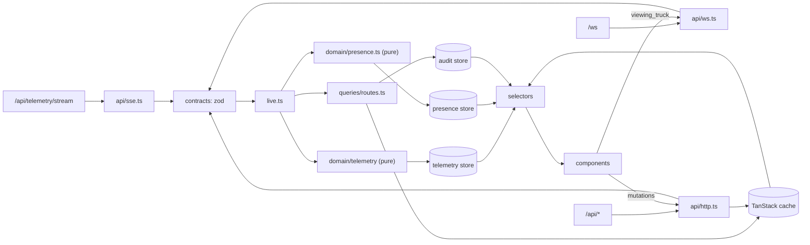

# FleetPulse: real-time fleet dashboard

> Draft. Sections are completed stage by stage (see `docs/PLAN.md`); final version in Stage 8.

## Setup

Requires Node ≥ 20 and the latest Chrome.

```bash
npm install
npm start     # mock server on :3000 + Vite dev server on :5173 (open http://localhost:5173)
npm test      # typecheck + all tests
```

`server.js` is the assignment's mock server, unchanged. `.gitattributes` marks it `-text` so a Windows checkout never rewrites its line endings.
`npm run capture-fixtures` regenerates `tests/fixtures/*.json` from a fresh server instance.

## Architecture

API clients validate every inbound payload with zod and hand typed messages to one composition root
(`src/live.ts`). Telemetry goes through a pure TypeScript pipeline, with no React, into a Zustand store.
REST data lives in TanStack Query, and WebSocket route events are written into the same cache.
Components read through per-truck selectors.



| Folder            | Responsibility                                                            |
| ----------------- | ------------------------------------------------------------------------- |
| `src/api/`        | Talks to the server: REST (ky), SSE, WebSocket                            |
| `src/contracts/`  | zod schema + inferred type for every payload, one file per domain         |
| `src/domain/`     | Pure TypeScript, no React: telemetry pipeline, route rules, presence      |
| `src/stores/`     | Zustand stores for live data                                              |
| `src/queries/`    | TanStack Query options and cache updates                                  |
| `src/context/`    | `AppContext`: identity and socket (dependency injection only)             |
| `src/hooks/`      | Shared hooks                                                              |
| `src/components/` | React components, grouped by feature                                      |
| `src/utils/`      | Small helpers: backoff, JSON, dispatcher identity                         |
| `src/live.ts`     | Composition root: wires the API clients to stores and caches              |
| `tests/`          | All tests; `tests/fixtures/` holds payloads captured from the real server |

## Key decisions and trade-offs

| Decision                                       | Rejected alternative                        | Why                                                                                                                                |
| ---------------------------------------------- | ------------------------------------------- | ---------------------------------------------------------------------------------------------------------------------------------- |
| TanStack Query for REST                        | hand-rolled fetch state                     | keeps last data on error, cache writable from WS events                                                                            |
| ky for HTTP (TanStack retry off)               | own fetch wrapper / axios / ofetch          | built-in retry that honours `Retry-After`, GET-only retries, parsed error body; axios has no retry, ofetch retries 409 by default  |
| Zustand + selectors for live data              | Context / TanStack for SSE                  | per-truck subscriptions; Context re-renders all consumers on every tick                                                            |
| Context only for DI (identity, socket)         | module singletons                           | explicit wiring, testable; values practically never change                                                                         |
| Pure reducer for telemetry                     | stateful class / RxJS                       | same input → same output; tested without React, DOM or timers                                                                      |
| zod schemas, types inferred                    | hand-written guards + separate types        | one definition per shape, so the runtime check and the type can't drift                                                            |
| Prettier (`server.js` ignored)                 | no formatter                                | consistent formatting; the server must stay byte-identical                                                                         |
| Vite proxy (same origin)                       | calling :3000 directly                      | server sends no `Access-Control-Expose-Headers`, so `Retry-After` would be unreadable                                              |
| `concurrently` (devDep)                        | `&` or a hand-rolled spawn script           | works on Windows, kills both processes on Ctrl+C                                                                                   |
| No `"type"` in package.json, `vite.config.mts` | rename server to `.cjs`                     | `server.js` is CommonJS and must stay unchanged                                                                                    |
| `.gitattributes`: `server.js -text`            | `* eol=lf` for all files / local git config | only the server must stay byte-identical; `core.autocrlf=true` would add CR on checkout. Local config doesn't travel with the repo |
| One `tsconfig.json`, `src` only, no Node types | split app/node configs with `tsc -b`        | browser code can't import `node:*`; nothing in `src` needs Node, so a second config buys nothing                                   |
| Leaflet `CircleMarker`                         | default `Marker`                            | no icon-asset bundling issue; colour by status directly                                                                            |
| Own ~20-line `ErrorBoundary`                   | `react-error-boundary`                      | a few lines                                                                                                                        |
| Own `ConfirmDialog`                            | `window.confirm`                            | non-blocking, can disable itself if the route changes while open                                                                   |
| Plain validation functions                     | form library                                | three small forms                                                                                                                  |
| Arrays + `appendCapped` (N = 150)              | RingBuffer class                            | tiny N, immutable updates suit Zustand                                                                                             |
| Route `_version` for locking                   | truck `_version`                            | truck version bumps on every simulation tick                                                                                       |
| RTL + jsdom only for UI-behaviour tests        | Playwright e2e                              | a handful of UI tests; logic is tested as pure functions                                                                           |

## Handling multi-dispatcher conflicts

- **Optimistic locking.** Every status change sends `If-Match: <route _version>`, using the version the dispatcher saw when deciding (captured when the confirm dialog opens), not whatever is in the cache at send time.
- **Who changed it.** On any 409 the client refetches `GET /api/routes` and takes the latest of `assignedAt` / `lastModifiedAt` / `reassignedAt` on that route (`lastActor`). The 409 body is never trusted: its `lastModifiedBy` ignores reassigns (it named Dana after Eli reassigned, see `tests/fixtures/rest.json`), and the processing-409 and the reassign-409 carry no actor at all.
- **No optimistic UI, no auto-retry.** A status change shows "Saving…" through the server's 200–1000 ms delay. On a conflict the dispatcher sees who did what and decides again with fresh data.
- **One entry point for changes.** Our own mutation results and the WS `route_*` events both go through `applyRouteChange`. The server broadcasts to the sender too, before it responds; the route version makes the second copy a no-op, so the audit log never shows a change twice.
- **Client-side rules the server doesn't enforce:** the status lifecycle (assigned → in-progress → completed, cancel before completion), no route for a maintenance truck, no reassigning a finished route, onto a busy truck or onto the same truck.
- **Confirm dialogs re-check live.** Complete, cancel and reassign need a confirmation. If a WS update changes the route while the dialog is open, Confirm is disabled with "Eli updated this route while this was open".

| Scenario                                   | Dispatcher A                                                                                                                                       | Dispatcher B                                                                                                                                                                                                 |
| ------------------------------------------ | -------------------------------------------------------------------------------------------------------------------------------------------------- | ------------------------------------------------------------------------------------------------------------------------------------------------------------------------------------------------------------ |
| Both want the same free truck              | The truck disappears from A's picker as soon as B's `route_assigned` arrives. In the remaining ms window A gets a 409: "route_4 was assigned by B" | 201; the route appears once                                                                                                                                                                                  |
| B changes a route while A's dialog is open | Confirm disabled: "B updated this route while this was open. Cancel and review."                                                                   | Success                                                                                                                                                                                                      |
| A's PATCH meets a stale version            | 409 → refetch → "route_1 was updated by B at 12:03:04. The list is now up to date."                                                                | Success. The server tells B nothing about A's attempt                                                                                                                                                        |
| A completes while B reassigns (quirk 8)    | Processing-409 without an actor → refetch → "route_1 was reassigned by B" (verified in two tabs)                                                   | Reassign succeeds                                                                                                                                                                                            |
| Reverse order: A's completion lands first  | Success                                                                                                                                            | The server has no If-Match on reassign, so B's stale reassign would move a completed route. B's dialog disables as soon as `route_updated(completed)` arrives; the remaining ms window is a known limitation |

The audit log covers only changes seen since the tab opened: the server has no route-history endpoint.

## What I'd monitor in production

_Stage 8._

## Known issues and limitations

_Stage 8._

## What I'd improve with more time

_Stage 8._
