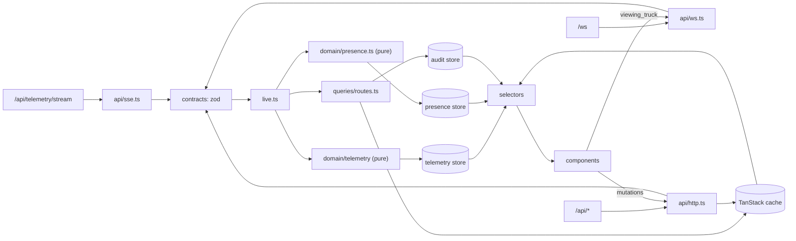

# FleetPulse Implementation Plan

> Destination: on approval this file is saved verbatim as `docs/PLAN.md`.
> Execution: one stage at a time; after each stage, STOP for the owner's review, self-quiz and commit. Steps use `- [ ]`.

**Goal:** A real-time fleet dashboard over the unchanged `server.js` mock that handles all 8 quirks, which the author can defend line by line.

**Architecture:** Thin API clients (SSE, WS, REST via ky) validate every inbound payload with zod schemas and pass typed messages to one composition root (`src/live.ts`). Telemetry goes through a **pure TypeScript reducer** (ordering, batch merge, anomaly detection, bounded buffers) into a Zustand store. REST data lives in TanStack Query, and WS route events are written into that same cache. Components read through per-truck selectors.

**Tech Stack:** React 19 + TypeScript strict + Vite, TanStack Query, Zustand, Leaflet/react-leaflet, Recharts, Vitest (+ RTL/jsdom where the test is about UI behaviour). Extra libraries: see the decision log (Stage 1).

**Spec:** `senior-test-4-assignment.html` (copied to `docs/assignment.html` in Stage 0). `server.js` line numbers below (`sNNN`) refer to the extracted file.

---

## Open questions (my proposed default is in brackets; please confirm or override before the stage that needs it)

| #   | Question                                                                                             | Needed by | Proposed default                                                                                                                                 |
| --- | ---------------------------------------------------------------------------------------------------- | --------- | ------------------------------------------------------------------------------------------------------------------------------------------------ |
| Q-1 | Alert `severity` enum: neither the spec nor the server defines one                                   | S7        | `info \| warning \| critical`                                                                                                                    |
| Q-2 | Route `priority` enum: the server defaults to `'normal'` and accepts anything                        | S5        | `low \| normal \| high`                                                                                                                          |
| Q-3 | `destination` format: the server accepts any truthy value                                            | S5        | free-text address, 1–120 chars after trim                                                                                                        |
| Q-4 | Low-fuel threshold: the spec gives none (the story mentions "15%")                                   | S3        | `< 15 %`                                                                                                                                         |
| Q-5 | Should the fleet snapshot be polled? The spec asks for 503 retry, but SSE already carries live state | S2        | No polling. Fetch on load, after an SSE reconnect, after `fleet_reset`, and from a manual "Retry" button. So 503s show up only on those fetches. |
| Q-6 | Map tiles need internet (OSM). Is offline review possible?                                           | S4        | OSM tiles; markers still render without tiles                                                                                                    |
| Q-7 | "Dispatcher auth" in the evaluation criteria: the server trusts any `X-Dispatcher-Id`                | S8        | Treat it as identity, not authentication; document it                                                                                            |

## Corrections to the brief (server.js checked line by line; the code wins)

1. **`Retry-After` is unreadable cross-origin.** CORS sets no `Access-Control-Expose-Headers` (s9–16), and `Retry-After` is not a CORS-safelisted header. A client on :5173 calling :3000 gets `null`. **Fix:** a Vite dev proxy (`/api`, `/ws` → :3000), so every call is same-origin.
2. **The PATCH 409 (version) `lastModifiedBy` can name the wrong person.** It is `route.lastModifiedBy || route.assignedBy` (s300), and reassign sets only `reassignedBy` (s370). After B reassigns, A's 409 names the original assigner. **Fix:** on every 409, refetch `GET /api/routes` and compute `lastActor(route)` = the latest of `assignedAt` / `lastModifiedAt` / `reassignedAt`. There is **no** `GET /api/routes/:id`, so the refetch is the list.
3. **If-Match must be a bare integer.** The server does `parseInt(ifMatch)` (s295). An RFC-style quoted ETag (`"3"`) parses to `NaN`, which gives a permanent 409.
4. **"Sim speed capped at 80"** is true only for live readings (s82). `gps_batch` speed is `speed ± 5` (s157), so it can be **negative** or up to 85. History speed is `max(0, speed ± 10)` ≤ 90 (s454). A threshold of 80 would raise false faults, so the profile uses `0 ≤ speed ≤ 130`.
5. **999 also fires while truck_7 is in `maintenance`** (s134 ignores status). Detection is a range check, independent of status and id.
6. **`POST /api/routes` silently activates a maintenance truck** (s270: `truck.status = 'active'`). The client-side block is therefore a correctness rule, not just UX.
7. **`EventSource` reconnects natively only on network errors.** If the proxy answers non-2xx (server still booting under `npm start`, or restarted), `readyState` becomes `CLOSED` permanently. A manual reconnect with backoff is needed.
8. **Out-of-order readings carry _current_ values with a timestamp 3–8 s old** (s177–181). Dropping them as "current" loses nothing: the next tick arrives in 2 s.
9. **`gps_batch` points are jitter around the _current_ location** (±0.001°, s154–155), 2–58 s back, and are sent _before_ that tick's `telemetry` (s169 vs s184). A path drawn from them is a scribble. That is a mock artifact; document it.
10. **The fuel glitch lasts 1–2 readings** (2–4 s window, 2 s cadence, s117–126). Batch readings never glitch fuel (s159).
11. **WS types missing from the spec table:** `pong` (s490) and `error` (`Invalid JSON`, s503). `dispatcher_left`, route events, `truck_alert` and `fleet_reset` reach the **sender too** (`broadcastWS` without exclude). After a reconnect, a ghost leave for _your own id_ arrives on your new socket.
12. **`fleet_reset`** (s412–419) also restarts route ids at `route_1`, re-randomises positions and resets versions, and empties the server's `dispatchers` while sockets stay open. So the client must also clear telemetry buffers and dedupe keys, and **re-register** so peers re-learn it.
13. **`server.js` is CommonJS** (`require`, s1–4). `package.json` must **not** set `"type": "module"`, otherwise `node server.js` crashes. The Vite config is therefore `vite.config.mts`.
14. **Truck `_version` bumps on every sim tick** (s103), so it is useless for locking. Only the route `_version` is used.
15. The reassign 409 body has **no actor** (s356). "Who" is resolved from the fresh routes list (the route that occupies the target truck).
16. `activeDispatchers` (s485, s517) counts ghosts and is zeroed by reset. It is not displayed.

## Global constraints

- **`server.js` is read-only for the whole project** (spec: "Do NOT modify the mock server"). Byte-identical to the spec's code block (HTML entities decoded); `.gitattributes` marks it `-text` so checkouts never convert its line endings. No edits, no reformatting, no rename, no `.cjs` copy, no wrapper that patches its behaviour, and `npm audit fix`/formatters must exclude it (`.prettierignore`). If any requirement seems to need a server change: **STOP and ask the owner**; the fix belongs in the client. Every stage's DoD includes `git diff --quiet <S0 commit> -- server.js` (exit 0).
- `npm install && npm start` starts server + client. `npm test` = typecheck + all tests, green after every stage.
- Latest Chrome only, no polyfills.
- No bonus features (circuit breaker included). No dependency for a few lines.
- `src/domain/telemetry/{profiles,detectors,buffers,pipeline}.ts` import nothing from React/Zustand/TanStack. Their tests run in Vitest's `node` environment (the default).
- Every mutation sends `X-Dispatcher-Id`. No `dangerouslySetInnerHTML` anywhere.

## Review focus (failure modes the spec implies but doesn't name; each has a test in its owning stage)

1. Browser loads before the server is listening (normal under `npm start`): SSE/WS must recover without a reload. **Test:** `sse: CLOSED triggers manual reconnect with backoff` (S2).
2. A telemetry reading for a truck not yet in the snapshot (SSE beats the possibly 503-retrying REST call): the truck must appear, with its id as name. **Test:** `pipeline: unknown truck creates entry` (S3).
3. `fleet_reset` mid-session: reused route ids must not be deduped against pre-reset audit keys. **Test:** `fleet_reset clears routes, audit, roster, telemetry and re-registers` (S6).
4. A route changes (via WS) while its confirm dialog is open: confirm must disable. **Test:** RTL `ConfirmDialog disables when route becomes completed` (S5).
5. A hostile peer name / id without our separator (another client implementation): rendered as text, with a fallback name. **Test:** `displayName: id without separator falls back to "Unknown"` (S2).

---

## Requirements traceability matrix

Sources: **BR** = Basic Requirements · **TR** = Technical Req. · **EV** = Evaluation Criteria · **SUB** = Submission · **Q1–Q8** = quirks · **sNNN** = server.js line · **B** = your brief. One row per requirement; where several sources say the same thing they share one row. **T-x** = a test defined in a stage; **M** = manual check.

| ID  | Requirement                                                                                                        | Source                                | Stage            | Verified by                                                      |
| --- | ------------------------------------------------------------------------------------------------------------------ | ------------------------------------- | ---------------- | ---------------------------------------------------------------- |
| R01 | Server code copied byte-for-byte; repo is a git repo                                                               | SUB1, SUB4, mock warning              | S0               | `git diff --quiet <S0 commit> -- server.js` in every stage's DoD |
| R02 | Real captured fixtures for every SSE/WS/REST shape incl. quirks                                                    | B                                     | S0               | fixture files exist; later tests import them                     |
| R03 | TS strict + React + Vite; latest Chrome, no polyfills                                                              | TR                                    | S1               | `tsc --noEmit` inside `npm test`                                 |
| R04 | `npm install && npm start` runs server + client (CJS server: no `"type":"module"`)                                 | TR, SUB5, s1–4                        | S1               | M: fresh clone on Windows                                        |
| R05 | `npm test` runs all and passes                                                                                     | TR, SUB6                              | S1               | M                                                                |
| R06 | Same-origin proxy for `/api` and `/ws` (Retry-After readable)                                                      | s9–16                                 | S1               | M: devtools shows header read; T-6                               |
| R07 | Typed contracts for every payload, including undocumented `pong`, `error`                                          | EV Event, s490, s503                  | S1               | tsc                                                              |
| R08 | Validate inbound SSE/WS + REST bodies at the boundary; drop invalid, keep valid siblings; drop `dispatcherId:null` | B, s494–501                           | S2               | T-11                                                             |
| R09 | SSE: all messages are unnamed `data:` events; no id/retry, so no replay; status `connecting/open/reconnecting`     | s422–439                              | S2               | T-sse                                                            |
| R10 | SSE `CLOSED` → manual reconnect with backoff                                                                       | ES spec                               | S2               | T-sse                                                            |
| R11 | Second `connected` = reconnect → refetch fleet + routes                                                            | s428                                  | S2               | T-sse                                                            |
| R12 | 503 retry honouring `Retry-After`, max 3 retries, last good data kept, manual Retry                                | BR1, Q7, s210–213                     | S2               | T-6                                                              |
| R13 | `X-Dispatcher-Id` on every mutation incl. alert (no server check, s392)                                            | EV Sec, s391                          | S2               | T-http                                                           |
| R14 | Register via WS; id persisted in `sessionStorage`; name encoded in id                                              | BR3, s471–487                         | S2               | T-ws, T-name                                                     |
| R15 | WS ping/pong keepalive + RTT; pong timeout → reconnect                                                             | s489–491                              | S2               | T-ws                                                             |
| R16 | WS reconnect with backoff, re-register same id, re-announce viewed truck                                           | B                                     | S2               | T-ws                                                             |
| R17 | Cleanup of every EventSource, WebSocket, timer, subscription                                                       | EV Event, B                           | S2               | T-ws, T-sse (`close()` leaves no timers) + S8 M audit            |
| R18 | Telemetry pipeline is framework-free TS                                                                            | EV Arch                               | S3               | node-env tests; import check in S8                               |
| R19 | New vehicle type = new profile entry, no detector edits                                                            | EV Arch                               | S3               | T-14                                                             |
| R20 | GPS batch: one marker; batch only extends path; current unchanged                                                  | BR1, BR5, Q1, s144–174                | S3               | T-1                                                              |
| R21 | Order by `reading.timestamp`, not arrival; never read `_reordered`/`_batch`                                        | BR1, BR5, Q5, s177–181                | S3               | T-2                                                              |
| R22 | Speed out of range (999, negative) flagged; last plausible shown; not truck_7-specific; limit not 80               | BR1, BR5, Q3, s108–114, s134, s157    | S3               | T-5                                                              |
| R23 | Fuel 0 glitch suppressed; never triggers low fuel                                                                  | BR1, BR5, Q2, s117–126, s136          | S3               | T-3                                                              |
| R24 | Sustained or gradual real low fuel _does_ alert                                                                    | BR5                                   | S3               | T-4a, T-4b                                                       |
| R25 | Bounded buffers: 150 samples + 150 path points per truck                                                           | NF, EV Perf                           | S3               | T-cap                                                            |
| R26 | All 12 trucks with live positions on a Leaflet map + list                                                          | BR1, TR                               | S4               | M                                                                |
| R27 | Visual status distinction active/idle/maintenance                                                                  | BR1                                   | S4               | M (legend)                                                       |
| R28 | Anomaly annotations + low-fuel badge in UI                                                                         | BR1                                   | S4               | T-readout                                                        |
| R29 | Connection + staleness indicator (no telemetry > 10 s; fleet retry state)                                          | B, s431                               | S4               | T-banner                                                         |
| R30 | One store update per SSE message; per-truck selectors; memoised markers/rows                                       | NF, EV Perf                           | S4               | M: React Profiler ≈ 1 commit / 2 s                               |
| R31 | Error boundary per major panel                                                                                     | EV Sec                                | S4               | M: forced throw in one panel leaves the others alive             |
| R32 | Create route; block maintenance + busy trucks; handle 401/400/404/409 `assignedBy`                                 | BR2, s236–283, s270                   | S5               | T-13, M                                                          |
| R33 | Status transitions enforced client-side (server accepts anything)                                                  | BR2, s317                             | S5               | T-8                                                              |
| R34 | `If-Match: <bare int>` always sent                                                                                 | BR2, Q4, s294–302                     | S5               | T-7                                                              |
| R35 | 409 shows WHO, for all kinds (create, version, processing, target busy)                                            | BR2, Q4, Q8, s247–253, s295–315, s356 | S5               | T-7, T-12                                                        |
| R36 | PATCH delay 200–1000 ms → pending UI, no optimistic update; PATCH↔reassign race                                    | Q8, s307                              | S5               | M two tabs                                                       |
| R37 | Reassign: block completed/cancelled/same/maintenance/busy; handle 409/400/404                                      | BR2, s345–388                         | S5               | T-8                                                              |
| R38 | Truck↔route mapping derived from the routes cache (completion → idle, reassign moves)                              | s324–331, s362–376                    | S5               | T-8 (`assignableTruckIds`)                                       |
| R39 | Audit log from WS route events + own results; capped 200; since tab opened                                         | BR2                                   | S5               | T-10                                                             |
| R40 | Own WS route echo deduped against mutation result, either arrival order                                            | s197–203, s273, s333, s378            | S5               | T-10                                                             |
| R41 | Route form validation (trim, required, lengths, enums)                                                             | EV Sec                                | S5               | T-13                                                             |
| R42 | Confirmation for reassign, cancel, complete; disables if route changes while open                                  | EV Sec                                | S5               | T-16                                                             |
| R43 | Conflict UX from both sides, 4 scenarios, documented                                                               | spec Tips                             | S5               | README section                                                   |
| R44 | Show other active dispatchers (no list message → reply-to-join)                                                    | BR3                                   | S6               | T-9e, M two tabs                                                 |
| R45 | Show which truck each dispatcher is viewing (map + list)                                                           | BR3, s494–501                         | S6               | M two tabs                                                       |
| R46 | Ghost: late leave after rejoin ignored; unknown/duplicate leave no-op                                              | BR3, BR5, Q6, s507–530                | S6               | T-9                                                              |
| R47 | `fleet_reset` clears routes, audit, presence, telemetry; re-register; refetch                                      | s412–419                              | S6               | T-15                                                             |
| R48 | Detail: speed, fuel, temp, mileage (only via `/api/fleet/:id`)                                                     | BR4, s208–228                         | S7               | M                                                                |
| R49 | Live charts speed/fuel/temp, seeded from history, animations off; history never drawn on map                       | BR4, s442–461                         | S7               | T-seed, M                                                        |
| R50 | Send alert; validate message + severity; show recent alerts from WS                                                | BR4, s391–409                         | S7               | T-alert                                                          |
| R51 | Assigned route details in panel                                                                                    | BR4                                   | S7               | M                                                                |
| R52 | ≥ 8 meaningful tests (batch, ooo, fuel, speed, locking, ghost)                                                     | BR5, TR, EV Testing                   | S8               | `npm test` listing                                               |
| R53 | Runs for hours: heap flat, no leaked connections/timers                                                            | EV Perf                               | S8               | M: 2 h run                                                       |
| R54 | Never render server strings as HTML                                                                                | B                                     | S8               | grep `dangerouslySetInnerHTML` = 0                               |
| R55 | README: setup, architecture/data flow, decisions, conflicts, monitoring, known issues, improvements                | SUB2, senior expectation              | S8               | checklist                                                        |
| R56 | PROMPTS.md with rejected/corrected AI output                                                                       | SUB3, EV AI                           | S8               | one entry per stage                                              |
| R57 | Known limits documented: notes can't be cleared (s318), no route-history endpoint, identity ≠ auth                 | s318, B                               | S8               | README "Known issues"                                            |
| R58 | Circuit breaker + all bonus features                                                                               | Bonus, EV Perf                        | **Out of scope** | listed in "Deliberately left out"                                |

---

## Stage 0 — Observe the real data

**Goal:** Capture real payloads of every message type and quirk as JSON fixtures before writing app code.
**Requirement IDs:** R01, R02
**Depends on:** —
**Time:** build 0.75 h + review 0.25 h
**Files:**

- `server.js`: spec code, entities decoded (`&amp;`→`&`, `&lt;`→`<`, `&gt;`→`>`), otherwise untouched.
- `docs/assignment.html`: the spec, for reference.
- `scripts/capture-fixtures.mjs`: tooling (not app code), kept so fixtures can be regenerated.
- `tests/fixtures/sse.json`, `rest.json`, `ws.json`: one file per channel, keyed by case.

**Design decisions:**

- Scripted capture over manual devtools copy, because the ghost leave (20 %) and the 999 window (8 %/3 s) need retries and timing a human won't do reliably. Rejected: hand-copied samples (not reproducible).
- Three fixture files keyed by case, not 30 files. Rejected: one file per message (noise in imports).

**Steps:**

- [ ] `git init`; `npm init -y`; `npm i express ws`.
- [ ] Extract `server.js`; `node --check server.js`; note its `sha256` in PROMPTS.md.
- [ ] Script, SSE (fetch stream): keep the first `connected`, `heartbeat` (wait ≥ 15 s), `telemetry`, `gps_batch`, a telemetry with any `fuel === 0`, one with `speed === 999`, one with a reading older than the message timestamp. Stop when all are captured (≤ ~3 min).
- [ ] Script, REST: `GET /api/fleet` until one 503 (store status, `Retry-After`, body) and one 200; `GET /api/fleet/truck_1`; `GET /api/telemetry/history/truck_1?limit=5`; POST route without header (401), without destination (400), unknown truck (404), twice on the same truck (409); PATCH with stale If-Match (409 version); PATCH with current If-Match, then PUT reassign during its delay (409 processing); reassign to busy (409) and to `truck_7` (400); alert (201).
- [ ] Script, WS: two `ws` clients A, B. Capture `registered`, `dispatcher_joined`, `dispatcher_viewing`, `pong`, `error` (send `"x"`), route events (from the REST step), `truck_alert`, `fleet_reset` (POST reset last). Loop: B registers, closes; record ms until A gets `dispatcher_left`; repeat until one arrives ≥ 9 s late (save with `closedAt`/`receivedAt`).
- [ ] Diff the captures against the matrix; fix any row they contradict; note the differences for PROMPTS.md.

**Tests:** none (no app code).
**Manual verification:** open `/api/telemetry/stream` in Chrome and watch a `gps_batch` arrive right before a `telemetry`. Check the delayed-leave fixture shows ≈ 10 s.
**Definition of done:** - [ ] all keys present in the 3 fixture files - [ ] delayed leave captured - [ ] matrix updated - [ ] `server.js` hash noted.
**Explain-back:** 1. Why does a batch's newest point trail the live reading by 2 s? 2. Which 409 has no actor, and why? 3. Why can't the browser read `Retry-After` from :3000? 4. What does the out-of-order reading actually contain?
**Self-quiz:** after review, run `anthropic-skills:architecture-explain` in quiz mode on `server.js` + `scripts/capture-fixtures.mjs` with the questions above.
**PROMPTS.md:** the capture prompt; every place the brief or AI summary was wrong about the server (the corrections list above).
**Commit:** `chore: add unchanged mock server and captured fixtures`
**STOP — wait for review.**

---

## Stage 1 — Architecture & scaffold

**Goal:** Lock module boundaries, contracts and tooling, with no feature code.
**Requirement IDs:** R03, R04, R05, R06, R07
**Depends on:** S0
**Time:** build 0.75 h + review 0.75 h
**Files:**

- `package.json`: scripts `start: concurrently -k -n server,web "node server.js" "vite"`, `test: tsc --noEmit && vitest run --passWithNoTests`; **no** `"type"`.
- `vite.config.mts`: react plugin; proxy `/api` → `http://localhost:3000`, `/ws` → `ws://localhost:3000` (`ws: true`); `test.environment: 'node'`.
- `tsconfig.json`: one config, `include: ["src"]`, `types: ["vite/client"]` only (no Node types, so browser code cannot import `node:*`); `strict`, `noUncheckedIndexedAccess`, `resolveJsonModule`.
- `.gitattributes`: `server.js -text`.
- `index.html`, `src/main.tsx` (QueryClientProvider), `src/App.tsx` (empty panel layout).
- `src/contracts/{fleet,telemetry,routes,presence,ws}.ts` + `index.ts`: every wire type (below), split by domain; `ws.ts` holds the cross-domain WS unions.
- `README.md`: setup + architecture diagram + decision log (draft). `PROMPTS.md`: journal started. `.gitignore`.

**Folder map** (standard React layout; changed after review in S2):

```
src/
  api/          http (ky), sse, ws, backoff, routes (S5)              talk to the server
  contracts/    zod schemas + inferred types, per domain     the wire contract
  domain/       pure TS, no React: telemetry/ (S3), routes/ (S5), presence.ts (S6), alerts.ts (S7)
  stores/       Zustand: connection, telemetry, presence, audit, alerts
  queries/      TanStack queryOptions + cache updates (fleet, routes, truck detail)
  context/      AppContext (DI only)
  hooks/        useNow, route mutations
  components/   IdentityGate; fleet/, routes/, presence/, detail/, ui/
  utils/        json, identity
  live.ts       composition root: api -> domain/stores/queries
  App.tsx, main.tsx, queryClient.ts
tests/          all tests, flat (*.test.ts); fixtures/ = captured server payloads
```

**Data flow:**



**Contracts (signatures only):**

```ts
type TruckStatus = 'active' | 'idle' | 'maintenance';
type RouteStatus = 'assigned' | 'in-progress' | 'completed' | 'cancelled';
interface LatLng { lat: number; lng: number }
interface TelemetryReading { truckId: string; location: LatLng; speed: number; heading: number; fuel: number; engineTemp: number; status: TruckStatus; timestamp: number }
type SseMessage =
  | { type: 'connected'; truckCount: number; timestamp: number } | { type: 'heartbeat'; timestamp: number }
  | { type: 'telemetry'; readings: TelemetryReading[]; timestamp: number } | { type: 'gps_batch'; truckId: string; readings: TelemetryReading[] };
interface FleetTruck { id; name; status; location; speed; heading; fuel; engineTemp; currentRouteId: string | null; _version: number }
interface FleetSnapshot { fleet: FleetTruck[]; timestamp: number }
interface TruckDetail extends FleetTruck { mileage: number; lastUpdate: number }
interface Route { id; truckId; destination: string; priority: string; notes: string; status: RouteStatus; assignedBy: string; assignedAt: number;
  lastModifiedBy?: string; lastModifiedAt?: number; reassignedBy?: string; reassignedAt?: number; _version: number }
interface HistorySample { truckId; location; speed; fuel; engineTemp; timestamp }
interface TruckAlert { id; truckId; message; severity: string; sentBy?: string; timestamp: number; acknowledged: boolean }
type WsInbound = registered | dispatcher_joined{dispatcherId,name} | dispatcher_left{dispatcherId} | dispatcher_viewing{dispatcherId, truckId?}
  | route_assigned{route,assignedBy} | route_updated{route,updatedBy} | route_reassigned{route,oldTruckId?,newTruckId,reassignedBy}
  | truck_alert{alert} | fleet_reset | pong | error{message};   // all carry timestamp except registered/error
type WsOutbound = { type: 'register_dispatcher'; dispatcherId: string; name: string } | { type: 'ping' } | { type: 'viewing_truck'; truckId: string | null };
// 409 bodies: CreateConflict{error,currentRouteId,assignedBy?} | VersionConflict{error,currentVersion,yourVersion,lastModifiedBy} | ProcessingConflict{error,currentVersion}
```

**Decision log** (goes into README):

| Decision                                     | Rejected alternative                 | Why                                                                                                                            |
| -------------------------------------------- | ------------------------------------ | ------------------------------------------------------------------------------------------------------------------------------ |
| TanStack Query for REST                      | hand-rolled fetch state              | keeps last data on error, cache writable from WS events                                                                        |
| ky for HTTP (TanStack retry off)             | own fetch wrapper / axios / ofetch   | built-in retry honouring `Retry-After`, GET-only retries, parsed error body; axios has no retry, ofetch retries 409 by default |
| Zustand + selectors for live data            | Context / TanStack for SSE           | per-truck subscriptions; Context re-renders all consumers on every tick                                                        |
| Context only for DI (identity, socket)       | global singletons                    | testable, explicit wiring; values change ~never                                                                                |
| Pure reducer for telemetry                   | class with internal state / RxJS     | same input → same output, testable without React or timers                                                                     |
| zod schemas, types inferred                  | hand-written guards + separate types | one definition per shape, so check and type can't drift (first built with guards, replaced after review)                       |
| Prettier (`server.js` ignored)               | no formatter                         | consistent formatting; the server must stay byte-identical                                                                     |
| Vite proxy, same-origin                      | direct :3000 calls                   | `Retry-After` is not exposed by CORS                                                                                           |
| `concurrently` (devDep)                      | `&` / hand-rolled spawn script       | cross-platform (owner is on Windows), kills both on Ctrl+C                                                                     |
| No `"type":"module"`, `vite.config.mts`      | rename server to `.cjs`              | server must stay unchanged                                                                                                     |
| Leaflet `CircleMarker`                       | default `Marker`                     | no icon-asset bundling bug, colour by status for free                                                                          |
| Own 20-line `ErrorBoundary`                  | `react-error-boundary`               | a few lines                                                                                                                    |
| Own `ConfirmDialog` (`role="dialog"`)        | `window.confirm`                     | non-blocking: can disable itself when the route changes underneath                                                             |
| Plain validation functions                   | form library                         | 3 small forms                                                                                                                  |
| Arrays + `appendCapped`                      | RingBuffer class                     | N = 150, copy cost trivial, immutable updates suit Zustand                                                                     |
| Route `_version` for locking                 | truck `_version`                     | truck version bumps every sim tick (s103)                                                                                      |
| `@testing-library/react` + `jsdom` (devDeps) | Playwright                           | only a few UI-behaviour tests; jsdom opted in per file                                                                         |

**Steps:**

- [ ] `npm create vite@latest . -- --template react-ts`; remove `"type"`; rename config to `vite.config.mts`.
- [ ] `npm i react react-dom @tanstack/react-query`; `npm i -D vite @vitejs/plugin-react typescript @types/react @types/react-dom vitest concurrently`. Each later stage installs only what it first uses (S2 `zustand`; S4 `leaflet react-leaflet` + `-D @types/leaflet jsdom @testing-library/react`; S7 `recharts`).
- [ ] Proxy + vitest config; tsconfig flags.
- [ ] Write `src/contracts/`, README draft with diagram + decision log.
- [ ] `npm test` green; `npm start` serves the empty layout and `http://localhost:5173/api/fleet` returns JSON.

**Tests:** none yet (`--passWithNoTests`); `tsc --noEmit` is the S1 gate.
**Manual verification:** delete `node_modules`, `npm install && npm start` on Windows; both processes up; Ctrl+C kills both.
**DoD:** - [ ] tsc strict clean - [ ] proxy works for `/api` - [ ] decision log in README - [ ] no feature code.
**Explain-back:** 1. Why must `package.json` omit `"type"`? 2. Why is the proxy a correctness requirement, not convenience? 3. Which modules may import React, and why does the vitest default environment enforce it? 4. Why zod rather than hand-written guards? 5. Where would a new data source plug in?
**Self-quiz:** `anthropic-skills:architecture-explain` quiz on `package.json`, `vite.config.mts`, `src/contracts/`, README diagram.
**PROMPTS.md:** scaffold prompt; whether the AI proposed `"type":"module"` or direct :3000 calls, and the correction.
**Commit:** `chore: scaffold vite react-ts with proxy, contracts and decision log`
**STOP — wait for review.**

---

## Stage 2 — Transport layer

**Goal:** Typed, validated, self-healing SSE/WS/REST clients with connection state and dispatcher identity.
**Requirement IDs:** R08, R09, R10, R11, R12, R13, R14, R15, R16, R17
**Depends on:** S1
**Time:** build 1.0 h + review 0.75 h
**Files:**

- `src/contracts/*.ts`: zod schemas (`SseMessageSchema` filters malformed readings one by one; `WsInboundSchema` is a discriminated union).
- `src/api/http.ts`: one ky instance (retry: limit 3, GET only, 502/503/504, waits `Retry-After` on 503); `getJson(path, schema, signal)`, `sendJson(method, path, {dispatcherId, body?, ifMatch?}, schema)`. Errors are ky `HTTPError` with the parsed body in `error.data`.
- `src/api/sse.ts`: `openTelemetryStream({onMessage, onStatus, onReconnected}, url?): () => void`.
- `src/api/ws.ts`: `openDispatcherSocket(identity, {onMessage, onStatus, onRtt, onReconnected}, url?)` returning `{ sendViewing(truckId | null), reregister(), close() }`.
- `src/api/backoff.ts` (SSE/WS reconnect delay), `src/utils/json.ts` (`parseJson` that never throws), `src/utils/identity.ts` (`createIdentity`, `loadIdentity` via a zod schema, `validateName`; sessionStorage).
- `src/stores/connectionStore.ts`: Zustand `{ sse, ws, wsRttMs }`.
- `src/context/AppContext.tsx`: `{ identity, socket }` + `useApp()`.
- `src/components/IdentityGate.tsx`: name form, shown until an identity exists.
- `src/queries/fleet.ts`: `fleetQueryOptions`. `src/queryClient.ts`: `createQueryClient()` (TanStack `retry: false`, `staleTime: Infinity`).
- `src/live.ts`: `startLive({ queryClient, identity }): { socket, stop() }`, called in an `App` effect whose cleanup is `stop()`.

**Design decisions:**

- Retry only transient failures (503, proxy 502/504 while server.js is down, network errors), max 3 retries, delay = `Retry-After` on 503 (capped 30 s), else ky backoff. One retry layer only (ky); TanStack retries are off. Mutations never retry (not idempotent).
- Name encoded in id (`Dana~a1b2c3d4`), because `dispatcher_viewing` carries only an id and there is no roster message. Rejected: a lookup protocol (no server support). Names restricted to `[A-Za-z0-9 ._-]{2,24}`, so `~` can't appear in a name.
- `sessionStorage` identity: reload keeps the same id, so "assigned by me" stays true and the ghost-rejoin case is real. Consequence: Chrome "Duplicate tab" copies it, giving two sockets with one id (documented). Rejected: `localStorage` (all tabs = one dispatcher, which breaks the two-tab conflict test).
- Pong timeout 10 s after each 15 s ping closes the socket, which detects half-open connections that `onclose` never reports.
- Invalid messages are dropped with a `console.warn`, never thrown into React. Malformed readings are filtered out of their frame (not counted: no consumer for a count until monitoring exists).
- `onReconnected` fires on the first open after **any** failure, including failed attempts before the very first open (server not up at page load). Found in manual testing: with "second open only" the snapshot stayed failed forever.

**Steps:**

- [ ] `npm i zustand` (connectionStore).
- [ ] `npm i ky zod`; contracts as schemas, tested against the fixtures.
- [ ] http on ky + retry tests.
- [ ] Write SSE/WS lifecycle tests with fake `EventSource`/`WebSocket` (`vi.stubGlobal`) and fake timers → implement → pass.
- [ ] Identity + gate; `startLive` wires statuses; second `connected` → `invalidateQueries(['fleet'])` + `['routes']`.

**Tests:**

- T-11 `contracts: every captured fixture parses without dropping a real reading; one malformed reading keeps the others; dispatcher_viewing with dispatcherId null is rejected`.
- T-6 `fleet query: 503 Retry-After 3 → next fetch not at 2999 ms, fetched at 3000 ms; 4×503 → error after 3 retries; previous snapshot still in data` (QueryClient + mocked fetch + fake timers).
- T-http `a mutation is never retried, even on 503; sendJson sends X-Dispatcher-Id and If-Match "2"`.
- T-sse `CLOSED → new EventSource after backoff; CONNECTING error left to the browser; reopen or first open after failures → onReconnected; close() clears the pending timer`.
- T-ws `on open sends register with the same id; after reconnect re-sends register then viewing_truck(last); no pong in 10 s → close + reconnect; close() stops pings and reconnects`.
- T-name `displayName("Dana~a1b2") = "Dana"; id without "~" → "Unknown (id)"; validateName rejects "<b>", "a", 25 chars`.

**Manual verification:** `npm start`, then stop/start only the server. Status goes reconnecting → open without reload. Devtools shows a 503 followed by a request ≈ 3 s later.
**DoD:** - [ ] all tests green - [ ] no `any` - [ ] each client's `close()` verified to leave no timers.
**Explain-back:** 1. Walk a 503 from fetch to retry. 2. Why manual reconnect when EventSource auto-reconnects? 3. What happens to identity on reload vs duplicate tab? 4. What does the pong timeout catch that `onclose` doesn't? 5. What happens to a malformed reading?
**Self-quiz:** `anthropic-skills:architecture-explain` quiz on `src/api/**`, `src/contracts/**`, `src/utils/**`, `src/live.ts`.
**PROMPTS.md:** AI-generated guard/retry code; anything rejected (e.g. retrying all errors, quoted ETag).
**Commit:** `feat(transport): validated sse/ws/rest clients with retry and reconnect`
**STOP — wait for review.**

---

## Stage 3 — Telemetry pipeline (TDD, pure TS)

**Goal:** A pure reducer that orders, merges batches, detects sensor faults and bounds memory, plus the Zustand store around it.
**Requirement IDs:** R18, R19, R20, R21, R22, R23, R24, R25
**Depends on:** S2
**Time:** build 1.25 h + review 1.0 h
**Files:** (as built; simpler than first planned, see the note below)

- `src/domain/telemetry/profiles.ts`: `VehicleProfile`, `PROFILES.truck` (0-130 km/h, drop > 5 % suspect, 10 s confirm, low < 15 %), `profileFor(truckId)`.
- `src/domain/telemetry/detectors.ts`: `SensorValue { value; fault }`, `checkSpeed(prev, raw, ts, profile)`, `checkFuel(prev, raw, ts, profile)`, `isLowFuel(fuel, profile)`.
- `src/domain/telemetry/pipeline.ts`: `TruckLive`, `FleetLive`, `applyTelemetry(fleet, telemetry | gps_batch)`, `BUFFER_CAP = 150`; private `mergeByTimestamp` for samples and path.
- `src/stores/telemetryStore.ts`: `{ fleet, lastTelemetryAt, ingest(message, receivedAt) }`.
- `src/live.ts`: SSE `telemetry` / `gps_batch` → `ingest`.

Simplified from the first plan: no `FuelGuard` (the fuel state is fully a `SensorValue`: trusted = `value`, suspect-since = `fault.since`); no `buffers.ts` (one private merge function covers samples and path); no `applySnapshot` (SSE fills every truck within 2 s, the snapshot is used for names only). Selectors (`useTruckIds`, `useTruck`) come with their first reader in S4, `reset()` with `fleet_reset` in S6.

**Algorithm (what the tests pin):**

- Per reading: `ts > lastReadingAt` → becomes current, runs detectors, appends a sample + path point. Otherwise (late or batch) → path only via `mergeByTimestamp`, no detectors. Equal timestamps are not current.
- Speed: `raw < min || raw > max` → keep the previous value, fault since the first bad ts. In range → value, no fault.
- Fuel: no trusted value → accept. `trusted − raw > 5` → suspect (display trusted, fault `sudden_drop`). While suspect: back within 5 of trusted → glitch over, accept. Still low after `≥ 10 s` (reading time, not wall clock) → real, accept. Rises always accepted (refuel).
- Low fuel = `fault === null && value < 15`. A glitch can never alert. A real drop alerts after 10 s. A gradual decline alerts immediately.
- Chart sample stores `null` for faulted sensors (honest gap). The readout shows the last plausible value + annotation.
- One `set()` per SSE message. A truck not in the message keeps its object identity.

**Design decisions:**

- Rule-based detectors on reading timestamps. Rejected: statistical (z-score) detection, which needs tuning and is harder to defend. Rejected: `fuel === 0` / `truckId === 'truck_7'` checks (spec says detect, not special-case).
- Absolute drop threshold (5 points per reading) instead of a rate: real consumption ≈ 0.02/reading, so 5 is 250× margin; simple to explain. The 10 s confirmation window is 2.5× the server's max glitch length (4 s).
- Late/batch readings feed only the path. Their values are either current values with old timestamps (s177) or jittered (s157), so detectors on them would be noise.
- N = 150: 5 min of 2 s readings (chart window) and room for a 29-point batch. 12 × 300 small objects ≈ negligible memory.
- One store write per SSE message rather than a rAF/timer flush, because the server emits ≤ 2 messages per 2 s tick. `shortcut:` comment marking where a flush scheduler goes if the source gets chattier.

**Steps (TDD: each test written and seen failing before code):**

- [ ] `tests/telemetry.test.ts` written first and seen failing.
- [ ] `profiles.ts`, `detectors.ts`, `pipeline.ts` until green.
- [ ] Store + live wiring; read the store from the browser to watch real faults.

**Tests** (`tests/telemetry.test.ts`, 8 cases, driven by the real captured sequences where they exist):

- the real fuel 0 % glitch (truck_8) is never shown and never alerts; the fault is set only on the zero readings.
- a sustained drop is held as `sudden_drop` for 10 s, then accepted as real and alerts.
- a gradual decline alerts on the first reading below 15 %, with no fault.
- the real stuck 999 on truck_7 is flagged `out_of_range`, the last plausible value (0) stays shown, and the chart sample is `null`; the fault clears on the next good reading.
- speed limits come from the profile (a custom 40 km/h profile flags 50; 85 and the default pass; -0.8 is flagged).
- a real `gps_batch` only extends the path (one truck, location and samples unchanged, path sorted).
- a real out-of-order reading enters the path but never becomes current.
- buffers keep the newest 150 samples and path points.

**Manual verification:** with logging on, wait for truck_7's 999 (≈ 1–2 min) and a fuel 0. Confirm the faults and recovery in the console.
**DoD:** - [ ] all S3 tests green in `node` env - [ ] no React/Zustand import in the 4 pure files - [ ] every threshold lives in `profiles.ts`.
**Explain-back:** 1. Trace a `gps_batch` through `applyTelemetry`. 2. Why can a glitch never fire low-fuel, and what's the cost for a real leak? 3. Why don't late readings run detectors? 4. Why 150, why 130 km/h, why 10 s? 5. How do you add a "van" type?
**Self-quiz:** `anthropic-skills:architecture-explain` quiz on `src/domain/telemetry/**`.
**PROMPTS.md:** TDD loop; any AI detector that hard-coded `0` / `truck_7` / `80`, and how it was corrected.
**Commit:** `feat(telemetry): ordering, batch merge, sensor anomaly detectors`
**STOP — wait for review.**

---

## Stage 4 — Fleet overview UI

**Goal:** Map + list showing live positions, status, anomalies and connection health without wasted re-renders.
**Requirement IDs:** R26, R27, R28, R29, R30, R31
**Depends on:** S3
**Time:** build 0.75 h + review 0.5 h
**Files:** (as built)

- `src/components/fleet/FleetMap.tsx`: `MapContainer` + one memo `TruckMarker` per id + `Polyline` for the selected truck's path.
- `src/components/fleet/TruckMarker.tsx`: subscribes via `useTruck(id)`; fill = status colour; red ring if low fuel, amber ring if any sensor fault; tooltip with name.
- `src/components/fleet/TruckList.tsx`: memo rows: name (button), status, speed and fuel with the fault note, low-fuel badge.
- `src/components/fleet/statusStyle.ts`: `STATUS_COLOR`.
- `src/components/ConnectionBanner.tsx`: live data (open / reconnecting / "no update for Ns"), dispatch link + RTT, truck list error + Retry.
- `src/components/ErrorBoundary.tsx`: class boundary with "Try again"; wraps the map and the list.
- `src/hooks/useNow.ts`: one interval, cleared on unmount.
- `src/utils/format.ts`: `formatSensor(sensor, unit)` → `{ text, warning }`; never includes the raw faulty value.
- `src/stores/telemetryStore.ts`: + `useTruckIds()` (numeric sort, `useShallow`), `useTruck(id)`, `isStale(lastTelemetryAt, now)`, `STALE_AFTER_MS = 10_000`.
- `src/queries/fleet.ts`: + `useTruckName(id)` (TanStack `select`; falls back to the id).
- `src/App.tsx`: layout, `selectedId` state, boundaries.

**Design decisions:**

- Selection in `App` `useState`, passed as props. Rejected: a store (one owner, 3 readers).
- Names from the TanStack fleet query, live data from Zustand. They change at different rates from different sources.
- The path is drawn for the selected truck only: 12 polylines add nothing and the batch path is jitter.

**Steps:**

- [ ] `npm i leaflet react-leaflet`; `npm i -D @types/leaflet` (no jsdom/RTL: display logic is tested as pure functions).
- [ ] ErrorBoundary + useNow → map → list → readout → banner → App layout.
- [ ] Profile with React DevTools for 60 s.

**Tests** (`tests/display.test.ts`, node environment: no jsdom or Testing Library needed, the display rules are pure functions):

- a faulted sensor shows the last valid value with a warning and never the raw value (999); a null value shows "—".
- telemetry is stale only after more than 10 s without a reading; nothing received yet is not "stale".

**Manual verification:** truck_7 grey (maintenance) and annotated during 999. Fuel glitch never shows low fuel. Kill the server: banner reconnecting → stale; restart: live. Throw in `FleetMap` temporarily: list still works.
**DoD:** - [ ] 12 markers, one per truck, always - [ ] ≈ 1 commit per 2 s in profiler, unchanged rows not re-rendered - [ ] boundaries around map, list.
**Explain-back:** 1. Why does a row for truck A not re-render when B changes? 2. Where does a marker's name come from, and why not the store? 3. What does "stale" measure and why the client clock? 4. What survives a crash in the map panel?
**Self-quiz:** `anthropic-skills:architecture-explain` quiz on `src/components/fleet/**`, `src/components/ui/**`, `src/App.tsx`.
**PROMPTS.md:** UI prompts; any AI output that subscribed to the whole store or enabled chart/marker animation.
**Commit:** `feat(fleet): live map and list with anomaly and connection indicators`
**STOP — wait for review.**

---

## Stage 5 — Route management

**Goal:** Create, advance, cancel and reassign routes with optimistic locking, conflict UX that names the actor, confirmations and an audit log.
**Requirement IDs:** R32–R43
**Depends on:** S4
**Time:** build 1.5 h + review 1.0 h
**Files:**

- `src/api/routes.ts`: `fetchRoutes()`; `createRoute(dispatcherId, input: RouteInput)`; `updateRouteStatus(dispatcherId, route: Pick<Route,'id'|'_version'>, status)` (always `ifMatch: route._version`); `reassignRoute(dispatcherId, routeId, newTruckId)`.
- `src/domain/routes/transitions.ts`: `NEXT_STATUS = { assigned: ['in-progress','cancelled'], 'in-progress': ['completed','cancelled'], completed: [], cancelled: [] }`; `canTransition(from, to)`; `activeRouteForTruck(routes, truckId)`; `assignableTruckIds(trucks, routes)`; `canReassign(route, targetId, trucks, routes): { ok: true } | { ok: false; reason }`.
- `src/domain/routes/conflicts.ts`: `interface Actor { dispatcherId; action: 'assigned'|'updated'|'reassigned'; at }`; `lastActor(route): Actor`; `describeConflict(err: HttpError, fresh: Route[], ctx: { routeId?; truckId? }): ConflictInfo`.
- `src/domain/routes/validation.ts`: `validateRouteForm(raw, assignableIds)` → `{ ok: true; value } | { ok: false; errors }` (destination 1–120, notes ≤ 500, priority enum Q-2).
- `src/queries/routes.ts`: `upsertRoute(routes, next)` (replace only if `next._version > existing._version`, else same ref); `applyRouteChange(qc, { route, actor, kind, at })`, the **single** path for own results and WS events (cache + audit).
- `src/stores/auditStore.ts`: `{ entries (≤ 200, newest first); record(entry) /* ignores seen key `${routeId}@${_version}` */; clear() }`.
- `src/hooks/useRouteMutations.ts`: `useRoutes()`, `useCreateRoute()`, `useUpdateRouteStatus()`, `useReassignRoute()`. `onSuccess → applyRouteChange`; `onError 409 → await qc.fetchQuery(routes) → describeConflict`.
- `src/components/routes/`: `RoutesPanel`, `CreateRouteForm`, `RouteRow` (buttons only for allowed transitions; pending state while PATCH waits), `ConflictNotice`, `AuditLog`.
- `src/components/ui/ConfirmDialog.tsx`: `{ title; body; disabledReason: string | null; onConfirm; onCancel }`.
- `src/live.ts`: `route_assigned/updated/reassigned` → `applyRouteChange`.

**Design decisions:**

- "Who" always from the refetched route via `lastActor`, never from the 409 body alone (wrong after a reassign, absent in processing-409). Exception: create-409 uses `assignedBy` (it is correct there).
- No optimistic UI: show pending for the 200–1000 ms delay. Rejected: optimistic update + rollback, which flashes a state the other dispatcher never saw and makes conflicts more confusing.
- No auto-retry after 409: the dispatcher must re-decide with fresh data (the conflict _is_ the information).
- The version comparison in `upsertRoute` is the dedupe. The WS echo can beat the HTTP response (broadcast precedes `res.json`), so either order must converge.
- Only status is editable (spec scope). Notes/priority are set at creation, so the "notes can't be cleared" server bug never surfaces in the UI (still documented).
- The truck↔route map is derived from the routes cache, not the snapshot's `currentRouteId` (stale after any mutation).

**Conflict UX: what each dispatcher sees** (copy into README):

| Scenario                                  | Dispatcher A (loser)                                                                                                                                          | Dispatcher B (winner)                                                                                                                                                                                                                                                          |
| ----------------------------------------- | ------------------------------------------------------------------------------------------------------------------------------------------------------------- | ------------------------------------------------------------------------------------------------------------------------------------------------------------------------------------------------------------------------------------------------------------------------------ |
| Create on busy truck                      | 409 `assignedBy: B` → form keeps input, notice "Truck Delta was just assigned by B (route_4)". Delta disappears from A's picker once `route_assigned` arrives | 201; route appears once (echo deduped); audit "B assigned route_4 → Delta"                                                                                                                                                                                                     |
| PATCH version mismatch                    | Immediate 409 → refetch → "B started this route at 12:03:04; your cancel was not applied". Buttons re-render from v2; retry needs a new confirm               | Success. No signal about A's attempt (server sends none). Presence already showed A viewing that truck                                                                                                                                                                         |
| PATCH 409 during processing (two PATCHes) | Spinner ≤ 1 s → 409 without actor → refetch → "B completed this route at …"                                                                                   | Success                                                                                                                                                                                                                                                                        |
| PATCH racing reassign (Q8)                | A clicks Complete; B reassigns during A's delay → A gets processing-409 → "B reassigned this route to Truck Echo"                                             | Reassign succeeds. **Reverse order:** A completes first; B's reassign (no If-Match server-side) would move a completed route. B's dialog disables as soon as `route_updated(completed)` arrives; the residual ms window is a documented limitation, visible in both audit logs |

**Steps (TDD for pure files):**

- [ ] Tests T-8, T-12, T-13 → `transitions.ts`, `conflicts.ts`, `validation.ts`.
- [ ] Test T-10 → `cache.ts`, `auditStore.ts`.
- [ ] Test T-7 → `api.ts`, `describeConflict`.
- [ ] Hooks, components, ConfirmDialog; test T-16.
- [ ] WS route events in `live.ts`; README conflict section.

**Tests:**

- T-8 `all 16 status pairs: only the 4 allowed pass; canReassign rejects completed, cancelled, same truck, maintenance target, busy target; assignableTruckIds excludes maintenance + trucks with an active route`.
- T-12 `lastActor returns reassignedBy when reassignedAt is latest, lastModifiedBy when it is, assignedBy when untouched`.
- T-7 `updateRouteStatus sends If-Match "2" + X-Dispatcher-Id; 409 version fixture (lastModifiedBy=A) + fresh route reassigned by B → actor B; 409 processing fixture (no actor) → actor from fresh route`.
- T-10 `own result then WS echo (same version) → one audit entry, cache ref unchanged on echo; echo first then result → same; older-version event ignored`.
- T-13 `validateRouteForm trims; empty or 121-char destination rejected; unknown priority rejected; maintenance truck rejected`.
- T-16 (RTL) `reassign ConfirmDialog: confirm enabled, then cache update to completed → confirm disabled with reason` (RF-4).

**Manual verification (two tabs, two names):** run each conflict-table row. Watch the PATCH delay spinner. Reassign to truck_7 → blocked client-side. Check each tab's audit log shows both dispatchers' actions with names.
**DoD:** - [ ] every row of the conflict table reproduced - [ ] every route change confirmed - [ ] no duplicate audit entries - [ ] all tests green.
**Explain-back:** 1. Why not trust `lastModifiedBy` in the 409? 2. Walk both arrival orders of your own echo. 3. Why no optimistic update? 4. What can still go wrong with reassign, and why can't the client fully fix it? 5. Where does "truck is busy" come from?
**Self-quiz:** `anthropic-skills:architecture-explain` quiz on `src/domain/routes/**`, `src/components/routes/**`, `src/components/ui/ConfirmDialog.tsx`.
**PROMPTS.md:** conflict-handling prompts; AI suggestions rejected (optimistic updates, quoted ETag, trusting the 409 body, auto-retry on 409).
**Commit:** `feat(routes): optimistic locking, conflict attribution, audit log`
**STOP — wait for review.**

---

## Stage 6 — Dispatcher presence

**Goal:** A roster and per-truck "who is viewing" that is correct despite missing roster messages, ghost leaves and resets.
**Requirement IDs:** R44, R45, R46, R47
**Depends on:** S5 (fleet_reset touches the routes cache + audit)
**Time:** build 0.5 h + review 0.5 h
**Files:**

- `src/domain/presence.ts`: `displayName(dispatcherId)` (moved here from S2: first real caller; an id without `~` falls back to the whole id, never a truncated prefix); `interface Peer { id; name; viewingTruckId: string | null; joinedAt: number | null }`; `GHOST_GRACE_MS = 12_000` (server delays 20 % of leaves by 10 s, s508–516, + 2 s margin); `reducePresence(roster: ReadonlyMap<string, Peer>, msg, now, selfId): ReadonlyMap<string, Peer>`.
- `src/stores/presenceStore.ts`: `{ roster; apply(msg, now); clear() }`; `useViewersOf(truckId)`.
- `src/components/presence/DispatcherRoster.tsx`, `src/components/presence/ViewerBadges.tsx` (used in `TruckMarker` tooltip + `TruckList` row).
- `src/live.ts`: presence messages → store; on peer `dispatcher_joined` → `socket.sendViewing(current)` (reply-to-join); on own WS reconnect → `roster.clear()` + invalidate routes; `handleFleetReset(deps)`.
- `src/App.tsx`: selection change → `socket.sendViewing(id | null)`.

**Rules:** joined → upsert with name + `joinedAt = now`. viewing → upsert (name from `displayName(id)` if unknown), set truck. left → unknown id: same ref; `now − joinedAt < GHOST_GRACE_MS`: ignore (belongs to the previous connection); else delete. Own id: ignored.

**Design decisions:**

- **Reply-to-join** for roster population: each client answers a `dispatcher_joined` with its `viewing_truck`, so the newcomer learns everyone with no timer. Rejected: periodic presence heartbeat (timers, O(N) chatter forever).
- **Grace window** for ghosts: the observer can't tell a late leave from a real one (no connection id; the leave's timestamp is send time). Rejected: self-heal by re-registering on seeing your own leave, which briefly removes the live dispatcher and so violates R46. Cost: a dispatcher who genuinely leaves < 12 s after rejoining stays listed until the next reset/reconnect (documented).
- `fleet_reset` → clear roster + re-register, so peers re-learn each other via reply-to-join.

**Steps (TDD):**

- [ ] T-9 tests → `reducer.ts` → store.
- [ ] live wiring; T-15 → `handleFleetReset`.
- [ ] Roster + badges.

**Tests:**

- T-9a `leave for unknown id returns same roster ref`.
- T-9b `duplicate leave: second is a no-op`.
- T-9c `X joined at t=0, leave at t=9 s → X still present (ghost of previous connection)`.
- T-9d `X joined at t=0, leave at t=13 s → removed`.
- T-9e `dispatcher_viewing from unknown "Dana~ab12" adds Dana viewing truck_3; viewing null clears`.
- T-15 `handleFleetReset: routes cache empty, audit cleared, roster cleared, telemetry reset, reregister called, fleet+routes invalidated` (RF-3).

**Manual verification (two tabs):** open A, then B: each sees the other within 1 s. Select trucks: badges move. Reload B repeatedly until a ghost leave occurs (≈ 1 in 5): A keeps B listed. Close B for good: A removes it (now or 10 s later). `POST /api/reset`: both rosters recover.
**DoD:** - [ ] all T-9 + T-15 green - [ ] no flicker on reload of a peer - [ ] `activeDispatchers` not displayed.
**Explain-back:** 1. How does a newly opened tab learn who is already online? 2. Why 12 s, and what's the failure mode? 3. Why ignore your own id? 4. What does reset clear and why re-register?
**Self-quiz:** `anthropic-skills:architecture-explain` quiz on `src/domain/presence.ts`, `src/components/presence/**` + presence part of `src/live.ts`.
**PROMPTS.md:** presence design prompts; rejected options (heartbeat, self-heal) with reasons.
**Commit:** `feat(presence): dispatcher roster, viewing indicators, ghost handling`
**STOP — wait for review.**

---

## Stage 7 — Vehicle detail panel

**Goal:** Clicking a truck shows mileage, live charts seeded from history, its route and an alert form.
**Requirement IDs:** R48, R49, R50, R51
**Depends on:** S6
**Time:** build 0.75 h + review 0.5 h
**Files:**

- `src/queries/fleet.ts`: `truckDetailQuery(id)`, `historyQuery(id)` (`?limit=150`).
- `src/domain/telemetry/pipeline.ts`: `seedSamples(fleet, truckId, history): FleetLive` (TDD; history is older than live, merged by timestamp, speed run through `checkSpeed` statelessly, never into `path`).
- `src/stores/telemetryStore.ts`: `seed(id, history)`.
- `src/components/detail/TruckDetail.tsx`: header (name, status, mileage, last reading), assigned route (via `activeRouteForTruck`), charts, alerts.
- `src/components/detail/TelemetryCharts.tsx`: three Recharts `LineChart`s from `samples`, `isAnimationActive={false}`, `connectNulls={false}`, `dot={false}`.
- `src/domain/alerts.ts` (validateAlert) + `src/stores/alertsStore.ts`: `validateAlert(raw)` (message 1–200 trimmed, severity Q-1); `useAlertsStore` (≤ 50, dedupe by `alert.id`).
- `src/components/detail/AlertForm.tsx`: POST via `sendJson`, shows "sent" on 201.
- `src/live.ts`: `truck_alert` → alerts store (own echo included, so the list has one source).

**Design decisions:**

- History seeds charts only. Its locations drift up to ±0.03° (s450–451), so it is never drawn on the map.
- The alert list is fed only by WS (own echo included). Rejected: merging the POST result too, which would need a second dedupe path.
- Mileage fetched on open, no refetch interval (static in the sim).

**Steps:** - [ ] `npm i recharts` - [ ] T-seed → `seedSamples` - [ ] T-alert → `validateAlert` - [ ] queries + panel + charts + form, inside an ErrorBoundary.
**Tests:**

- T-seed `history older than live samples is prepended in order, duplicates by ts skipped, total ≤ 150, path untouched`.
- T-alert `validateAlert trims; rejects empty, 201 chars, severity "urgent"`.

**Manual verification:** open truck_1: charts full immediately, then extend every 2 s. Open truck_7 during 999: speed chart shows a gap, not a spike. Send an alert from tab A: both tabs list it once.
**DoD:** - [ ] mileage shown - [ ] no chart animation - [ ] alert validated - [ ] panel crash isolated.
**Explain-back:** 1. Why seed charts but not the path from history? 2. Why `null` in chart samples instead of the last plausible value? 3. Why is WS the only source for the alert list? 4. What triggers a detail refetch?
**Self-quiz:** `anthropic-skills:architecture-explain` quiz on `src/components/detail/**`, `seedSamples`.
**PROMPTS.md:** chart/panel prompts; corrections (animations, history drawn on map).
**Commit:** `feat(detail): truck panel with seeded live charts and alerts`
**STOP — wait for review.**

---

## Stage 8 — Hardening & docs

**Goal:** Prove it runs for hours, audit cleanup/safety, and finish README + PROMPTS.
**Requirement IDs:** R52, R53, R54, R55, R56, R57
**Depends on:** S7
**Time:** build 0.75 h + review 0.5 h (the 2 h soak runs unattended)
**Files:** `README.md`, `PROMPTS.md`; fixes found by the audits only.
**Steps:**

- [ ] Soak: two tabs, 2 h. Heap snapshot at 5 min and 2 h: retained size flat (buffers bounded). `chrome://webrtc-internals` not needed; check the Network tab shows exactly 1 EventSource + 1 WS per tab after reconnects.
- [ ] Cleanup audit: every `setInterval`/`setTimeout`/`addEventListener`/`subscribe` has a matching teardown (grep list in PROMPTS).
- [ ] Safety audit: `grep -r dangerouslySetInnerHTML src` = 0; every mutation goes through `sendJson`; every panel wrapped in an ErrorBoundary; pure files import no React.
- [ ] Test audit: list tests in README with the edge case each proves (≥ 8 required; plan has ~30 cases).
- [ ] README: setup; architecture + data-flow diagram; decision log; conflict table; **production monitoring** (below); known issues (risks list below); improvements.
- [ ] PROMPTS.md: finalise; include a "what the AI got wrong" summary.

**Production monitoring (README section, no UI):**

| Signal                                                         | Why                                                                                  |
| -------------------------------------------------------------- | ------------------------------------------------------------------------------------ |
| SSE reconnects + gap duration                                  | no replay, so every gap is lost path/chart data                                      |
| Events/s and readings/s per client                             | capacity and render budget; spots a stalled stream                                   |
| Late/batch readings rate per truck                             | GPS signal quality per vehicle                                                       |
| Anomalies per truck/sensor (flagged vs confirmed vs recovered) | sensor maintenance, and detector tuning (a false low-fuel was the original incident) |
| 409 rate by kind                                               | dispatcher contention; whether presence cues reduce it                               |
| 503 rate, retries, outcome (ok after n / gave up)              | backend load; detect retry storms                                                    |
| WS RTT p50/p95, reconnects, pong timeouts                      | presence freshness; half-open sockets                                                |
| Guard rejections by message type                               | contract drift between server and client                                             |
| Error-boundary catches by panel + unhandled errors             | client stability                                                                     |
| JS heap over session length                                    | leaks in an app meant to stay open all shift                                         |

**Tests:** none new, unless an audit finds a bug (then a regression test first).
**Manual verification:** fresh clone → `npm install && npm start` → `npm test` on Windows.
**DoD:** - [ ] soak passed with numbers recorded in README - [ ] all audits clean - [ ] README has every SUB2 section + monitoring - [ ] PROMPTS complete.
**Explain-back:** 1. What did the heap do over 2 h, and why? 2. Name every long-lived resource and where it's closed. 3. Which three signals would you alert on first? 4. Which known limitation worries you most in production?
**Self-quiz:** `anthropic-skills:architecture-explain` quiz on the whole repo (walkthrough of SSE → screen first, then quiz).
**PROMPTS.md:** audit prompts; final reflection on AI usage.
**Commit:** `docs: readme, monitoring plan and prompts journal`
**STOP — final review.**

---

## Time budget

| Stage   | Build   | Review/learn | Total                       |
| ------- | ------- | ------------ | --------------------------- |
| S0      | 0.75    | 0.25         | 1.0                         |
| S1      | 0.75    | 0.75         | 1.5                         |
| S2      | 1.0     | 0.75         | 1.75                        |
| S3      | 1.25    | 1.0          | 2.25                        |
| S4      | 0.75    | 0.5          | 1.25                        |
| S5      | 1.5     | 1.0          | 2.5                         |
| S6      | 0.5     | 0.5          | 1.0                         |
| S7      | 0.75    | 0.5          | 1.25                        |
| S8      | 0.75    | 0.5          | 1.25                        |
| **Sum** | **8.0** | **5.75**     | **13.75 h** (buffer 2.25 h) |

Stage order is as suggested. No merges: each stage is one reviewable concern. Presence comes after routes only because `fleet_reset` needs the routes cache and audit store to exist.

## (a) Traceability gaps

None. R01–R57 each map to one stage. R58 (circuit breaker + bonus features) is deliberately out of scope.

## (b) Risks & known limitations (README "Known issues")

- No SSE replay: reconnect gaps lose readings (snapshot refetch restores the current state only).
- Batch path is jitter around the current position (mock artifact); late readings carry current values with old timestamps.
- A real sudden fuel drop alerts only after the 10 s confirmation window.
- Speed detection is range-only; a sensor stuck at a _plausible_ value is not detected.
- Ghost grace window: a genuine leave < 12 s after a rejoin leaves a stale roster entry.
- Duplicated tabs share a `sessionStorage` identity.
- `X-Dispatcher-Id` is identity, not auth: anyone can claim any id.
- Reassign has no server-side If-Match/status check: a few-ms race with a completing PATCH remains.
- Route notes can't be cleared (server `if (notes)`); not editable in the UI anyway.
- Audit log is per tab, since connection, lost on reload (no history endpoint).
- No circuit breaker: after 3 failed retries the snapshot waits for a manual Retry or the next reconnect.
- OSM tiles need internet; Chrome-only.

## (c) Deliberately left out (ponytail)

Circuit breaker and every bonus feature · form library · router · CSS framework · RingBuffer class · rAF/timer flush scheduler · optimistic updates · side-by-side conflict merge · presence heartbeat · notes/priority editing · e2e/Playwright · engine-temp anomaly detection · vehicle-type field (the API has none).
